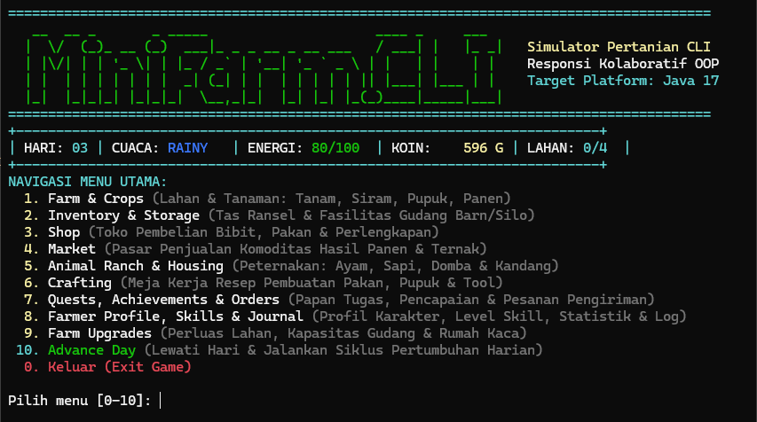

# MiniFarm Simulator CLI

A Java 17 command-line farming simulator where you manage crop plots, raise livestock, craft supplies, complete quests and delivery orders, upgrade your farm, and progress through daily weather and energy cycles.

## Preview



## How to Run

**Prerequisites:** Java 17+

1. Package the application JAR (using the `full` Maven profile):

   **Windows (PowerShell / CMD):**
   ```powershell
   .\mvnw.cmd -Pfull package
   ```

   **macOS / Linux:**
   ```bash
   ./mvnw -Pfull package
   ```

2. Run the game:

   ```bash
   java -jar target/minifarm-simulator-1.0.0-SNAPSHOT.jar
   ```
